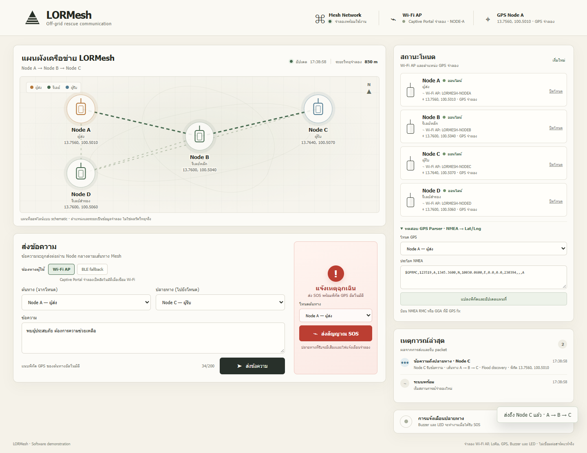

# LORMesh — Off-Grid Mesh Communication

Python-based mesh communication software for off-grid rescue scenarios, with multi-hop messaging, SOS packets carrying source coordinates, automatic rerouting, and a local web dashboard. Includes NMEA parsing and automated routing/API tests.

ซอฟต์แวร์เครือข่ายสื่อสาร Mesh สำหรับงานกู้ภัย รองรับการส่งข้อความหลายโหนด SOS พร้อมพิกัด การเปลี่ยนเส้นทางอัตโนมัติ และการแสดงสถานะผ่าน Web App พัฒนาด้วย Python พร้อมชุดทดสอบ routing และ HTTP API

## สถานะการพัฒนา

| ความสามารถ | สถานะปัจจุบัน |
| --- | --- |
| ส่งข้อความและเลือกโหนดปลายทาง | ทำงานผ่าน Web App และ Python API |
| ส่งต่อหลาย hop | ทดสอบ A → B → C ในระบบจำลอง |
| Flood + AODV-like routing | มี Flood discovery และ route cache แบบย่อ ยังไม่ใช่ AODV เต็มรูปแบบ |
| Message ID / TTL | ป้องกันการรับซ้ำภายในการส่งหนึ่ง packet และจำกัดจำนวน hop พร้อมชุดทดสอบ |
| เปลี่ยนเส้นทางเมื่อรีเลย์ล่ม | ทดสอบ A → D → C เมื่อ Node B ออฟไลน์ |
| SOS พร้อมพิกัด / Buzzer / LED | Broadcast และแสดงผลในระบบจำลอง เสียงและไฟจำลองผ่าน browser |
| NMEA → latitude/longitude | แปลง RMC/GGA ตรวจ checksum และสถานะ fix จากข้อมูลที่ป้อน |
| แผนที่และสถานะโหนด | มี schematic SVG ออฟไลน์และ polling สถานะทุก 2 วินาที ยังต้องเพิ่ม Leaflet.js |
| Wi-Fi AP / Captive Portal / BLE | มีตัวเลือกโหมดจำลอง ยังไม่ได้เชื่อมอุปกรณ์จริง |
| Firmware และ LoRa radio | ยังต้องพัฒนา adapter/firmware และทดสอบกับฮาร์ดแวร์ |
| ระยะส่ง ความทนทาน และต้นทุน | ยังไม่มีผลวัดภาคสนามหรือการเปรียบเทียบต้นทุนจริง |

ดูสถานะงานและเกณฑ์พัฒนาขั้นต่อไปใน [PLAN.md](PLAN.md)

## ภาพตัวอย่าง

ภาพจาก Web App ที่ทดสอบกับ Python HTTP API จริงบนเครื่อง โดยการส่งวิทยุและอุปกรณ์ยังเป็นการจำลอง



[ดูภาพหน้าจอมือถือ](docs/demo-dashboard-mobile.png)

## ความสามารถของระบบ

- ดูแผนผัง node A, B, C และ D บน schematic map ที่ทำงานออฟไลน์
- ส่งข้อความผ่าน Web App แล้วดูเส้นทาง A → B → C และพิกัด GPS ต้นทาง
- กด SOS เพื่อ broadcast ไปยัง node ที่ออนไลน์ พร้อมแนบพิกัด GPS อัตโนมัติ
- ดู event log ที่ปลายทาง รวมถึง Buzzer/LED จำลอง
- ปิด Node B เพื่อทดสอบเส้นทางสำรอง A → D → C แล้วเปิดกลับได้
- ใช้ Message ID กัน packet ซ้ำ และ TTL จำกัดจำนวน hop
- เลือกช่องทางผู้ใช้ Wi-Fi AP/Captive Portal หรือ BLE fallback ในโหมดจำลอง
- ป้อน NMEA RMC/GGA เพื่อทดสอบ parser และอัปเดตพิกัดบนแผนที่
- ระบบทำงานภายในเครื่อง ไม่เรียกแผนที่หรือ font จากอินเทอร์เน็ต

โครงข่ายเริ่มต้นใช้ A → B → C เป็นเส้นทางหลัก และ Node D เป็นรีเลย์สำรองสำหรับทดสอบการเลือกเส้นทางใหม่เมื่อ Node B ออฟไลน์

แผนผังเครือข่ายใช้ schematic SVG ที่ทำงานภายในเครื่องโดยไม่พึ่ง tile หรือ library ภายนอก ส่วนแผนที่ภูมิศาสตร์ Leaflet.js อยู่ในแผนพัฒนาต่อ

การส่งข้อความปกติใช้ Flood เพื่อค้นหาเส้นทางครั้งแรก แล้วเก็บเส้นทางที่พบไว้ใช้ส่งตรงในครั้งต่อไป หาก relay ในเส้นทางเดิมออฟไลน์ ระบบล้าง route นั้นและ flood เพื่อค้นหาเส้นทางใหม่ นี่เป็น **AODV-like route cache แบบย่อ** ไม่ใช่ implementation ของ AODV เต็มรูปแบบ

## เริ่มใช้งาน

ต้องมี Python 3.10 ขึ้นไป ไม่ต้องติดตั้งแพ็กเกจเพิ่ม

สำหรับผู้เริ่มต้นจาก GitHub ดาวน์โหลดโปรเจกต์ก่อน:

```bash
git clone https://github.com/nttpm-wan/LoRa-based-Off-Grid-Mesh-Network-.git lormesh
cd lormesh
```

```powershell
python -m lormesh.server
```

จากนั้นเปิด `http://127.0.0.1:8765` ในเบราว์เซอร์ กด `Ctrl+C` ในหน้าต่างคำสั่งเพื่อหยุด server

บน Windows ที่ใช้ Python Launcher สามารถเปลี่ยน `python` เป็น `py -3` ได้ หรือลองตัวอย่าง command line ด้วย `python -m lormesh.demo`

## รันทดสอบ

```powershell
python -m unittest discover -s tests -v
```

ชุดทดสอบ 37 รายการครอบคลุมการส่งหลาย hop, TTL, duplicate suppression, route cache/fallback, NMEA RMC/GGA, GPS และ SOS รวมถึงเปรียบเทียบ routing กับ BFS อิสระใน 1,536 กรณีของ topology/โหนดออฟไลน์/TTL

Integration tests เปิด HTTP server จริงบนพอร์ต localhost ที่ระบบเลือกให้อัตโนมัติ เพื่อตรวจทุก endpoint, input ผิดรูปแบบ และการส่งพร้อมกัน 24 คำขอ จึงต้องอนุญาตการเชื่อมต่อ loopback ในสภาพแวดล้อมที่ใช้ทดสอบ

Web App ผ่านการตรวจด้วย Chrome กับ API จริงที่ความกว้าง 320, 390, 768, 1024 และ 1440 พิกเซล รวมการเปลี่ยนเส้นทาง ผู้ใช้สองหน้าต่าง การหลุด/เชื่อมต่อใหม่ และ timeout ผลนี้ยังไม่ยืนยันประสิทธิภาพวิทยุหรือความพร้อมสำหรับใช้งานกู้ภัยจริง

มี [GitHub Actions workflow](.github/workflows/tests.yml) สำหรับรัน automated tests บน Python 3.10 และ 3.12 เมื่อ push หรือเปิด pull request ดูผลบน GitHub ได้ที่ [Actions](https://github.com/nttpm-wan/LoRa-based-Off-Grid-Mesh-Network-/actions)

## ไฟล์สำคัญ

| ไฟล์ | หน้าที่ |
| --- | --- |
| [lormesh/models.py](lormesh/models.py) | โครงสร้าง Node, Packet, พิกัด และผลการส่ง |
| [lormesh/network.py](lormesh/network.py) | Flood, route cache, Message ID, TTL และลิงก์ตามระยะจำลอง |
| [lormesh/gps.py](lormesh/gps.py) | แปลง NMEA RMC/GGA และตรวจข้อมูลพิกัด |
| [lormesh/demo_system.py](lormesh/demo_system.py) | สถานการณ์ A/B/C/D, GPS, ประวัติและเหตุการณ์ |
| [lormesh/server.py](lormesh/server.py) | HTTP API และ static file server |
| [web/index.html](web/index.html) | โครงสร้างหน้า dashboard |
| [web/app.js](web/app.js) | แผนผัง การส่งข้อความ/SOS และ polling |
| [web/styles.css](web/styles.css) | รูปแบบหน้าจอและ responsive layout |
| [tests/](tests/) | Unit tests, regression tests และ HTTP integration tests |
| [.github/workflows/tests.yml](.github/workflows/tests.yml) | ทดสอบอัตโนมัติบน GitHub Actions |
| [PLAN.md](PLAN.md) | แผนพัฒนาและเกณฑ์ทดสอบแต่ละขั้น |

## โครงสร้างโค้ด

```text
lormesh/
  models.py        # Node, Packet, GPS position, ผลการส่ง
  gps.py           # NMEA RMC/GGA → decimal latitude/longitude
  network.py       # Flood discovery, route cache, Message ID, TTL, range-based links
  demo_system.py   # สถานการณ์เดโม A/B/C/D และ event log
  server.py        # HTTP API และ static file server ด้วย Python standard library
  demo.py          # ตัวอย่าง command line A -> B -> C
web/
  index.html       # โครงสร้าง dashboard
  styles.css       # สี, layout, responsive styles
  app.js           # map, message/SOS controls, polling และ UI state
tests/
  test_network.py
  test_demo_system.py
  test_gps.py
  test_regressions.py
  test_server.py
```

## ขอบเขตการทำงาน

- โหนดและลิงก์ถูกจำลองใน Python process เดียว ยังไม่ใช่เครือข่ายกระจายบนอุปกรณ์หลายตัว

- ระยะวิทยุเป็นวงกลมระยะคงที่ที่ใช้สร้าง topology จากพิกัด ไม่คำนวณภูมิประเทศ เสาอากาศ กำลังส่ง interference, packet loss หรือ airtime
- การทำงานแบบ real-time ในเดโมหมายถึงหน้าเว็บ poll สถานะจำลองทุก 2 วินาที ไม่ใช่ GPS stream จากอุปกรณ์
- การแจ้งเตือน Buzzer เป็นเสียงจาก browser และ LED แสดงเป็นไฟกระพริบบนหน้าเว็บ
- ตัวเลือก Captive Portal และ BLE ในหน้าเว็บเป็นสถานะจำลอง ยังไม่ได้สร้าง Wi-Fi AP/DNS captive portal หรือเชื่อม Bluetooth จริง
- แผนที่ปัจจุบันเป็น schematic SVG ออฟไลน์ ไม่ใช่ Leaflet.js และไม่ได้แสดงแผนที่ภูมิศาสตร์หรือ tile จริง
- NMEA parser ทำงานจริงกับประโยคที่ป้อนในหน้าเว็บ แต่ GPS ในโหนดยังเป็นพิกัดจำลอง ไม่มีการอ่าน UART จาก NEO-6M
- หาก NMEA ระบุว่าไม่มี fix จะเก็บพิกัดล่าสุดไว้และติดป้ายในสถานะโหนด/ข้อความ/SOS ว่าเป็นพิกัดล่าสุดที่ยังไม่มี GPS fix ใหม่
- SOS นับว่าส่งสำเร็จเมื่อมีโหนดอื่นรับอย่างน้อยหนึ่งโหนด; เมื่อส่งไม่ถึงใคร หน้าเว็บไม่แสดงไฟหรือเล่นเสียงสำเร็จจาก SOS ครั้งก่อน
- API ตรวจชนิดข้อมูลและจำกัดข้อความ 200 หน่วย UTF-16 ให้ตรงกับ maxlength ของหน้าเว็บ เก็บประวัติข้อความ 30 รายการและเหตุการณ์หน้าเว็บ 40 รายการเพื่อจำกัดการใช้หน่วยความจำ
- ยังไม่มี firmware Arduino/C++ หรือการส่ง LoRa ทางอากาศ; route cache เป็นโมเดล AODV-like แบบย่อ
- ก่อนทดสอบกับอุปกรณ์จริง ต้องตรวจสอบรุ่นโมดูล การต่อขา radio parameters และข้อกำหนดคลื่นความถี่/กำลังส่งที่ใช้

## แผนพัฒนาต่อ

แผนพัฒนา Leaflet ออฟไลน์ การวัดผลจำลอง firmware และการทดสอบภาคสนาม พร้อมเกณฑ์จบแต่ละขั้น อยู่ใน [PLAN.md](PLAN.md)
